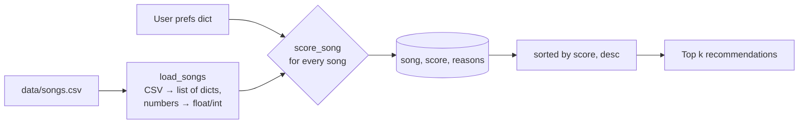

# 🎵 Music Recommender Simulation

## Project Summary

This project is a small content-based music recommender: **VibeFinder 1.0**. It reads an 18-song catalog from a CSV file and compares every song to a user's "taste profile" (favorite genre, favorite mood, target energy, and optionally whether they like acoustic sound). It gives each song a score and returns the top 5 with a plain-language list of reasons. It also has switchable scoring modes, so you can see how changing the weights changes the recommendations.

---

## How The System Works

### How real platforms do it

Apps like Spotify and YouTube mix two main approaches:

- **Collaborative filtering** uses other people's behavior. If listeners who share your history also loved a track you haven't heard, it gets recommended. This needs lots of user data (likes, skips, replays, playlist adds, listening time) and can find surprising matches, but it can't recommend brand-new songs that nobody has played yet (the "cold start" problem).
- **Content-based filtering** uses the song's own attributes, such as genre, tempo, energy, mood, and audio features like danceability or acousticness. It recommends songs that *sound like* what you already like, so it works for new songs, but it rarely surprises you.

Real systems combine both, alongside signals like skips (strong negative), saves and repeat plays (strong positive), and time of day. Then they rank millions of candidates in stages.

**My version is purely content-based.** There is only one user and no listening history, so it relies on song attributes. It gives the most weight to genre, then mood, then how close the song's energy is to what the user wants.

### Features used

| `Song` | `UserProfile` / prefs dict |
|---|---|
| `genre`, `mood` (categories) | `favorite_genre` → `"genre"` |
| `energy` (0–1) | `favorite_mood` → `"mood"` |
| `acousticness` (0–1) | `target_energy` → `"energy"` |
| also stored: `tempo_bpm`, `valence`, `danceability` (not scored yet) | `likes_acoustic` → `"likes_acoustic"` (optional) |

### Algorithm Recipe (balanced mode)

**Scoring rule (one song):**

- **+2.0** if the song's genre matches the user's favorite genre
- **+1.0** if the song's mood matches the user's favorite mood
- **up to +1.5** for energy closeness: `1.5 × (1 − |song.energy − target_energy|)`. A perfect match gets 1.5, and the points shrink as the gap grows. This rewards being *close* to the target instead of just being higher or lower.
- **up to +0.5** for acoustic fit (only if the user set `likes_acoustic`): `0.5 × acousticness` if they like acoustic songs, or `0.5 × (1 − acousticness)` if they don't

Each rule that fires adds a reason string, e.g. `genre match (+2.00)`.

**Ranking rule (the list):** score every song in the catalog, sort from highest to lowest, and keep the top *k*. The scoring rule judges one song by itself. The ranking rule is needed because a recommendation means "better than the others", and that only makes sense once every song has been compared.

Genre is worth more than mood because genre usually changes the whole sound (a "happy" metal song and a "happy" pop song are very different), while mood labels are fuzzier.

### Data flow



### Scoring modes (stretch)

`SCORING_MODES` in [src/recommender.py](src/recommender.py) holds sets of weights that can be swapped in for one another. The scorer stays the same; only the weights change.

| mode | genre | mood | energy | acoustic |
|---|---|---|---|---|
| `balanced` (default) | 2.0 | 1.0 | 1.5 | 0.5 |
| `genre_first` | 3.0 | 0.5 | 1.0 | 0.5 |
| `mood_first` | 1.0 | 2.5 | 1.5 | 0.5 |
| `energy_focused` | 1.0 | 1.0 | 3.0 | 0.5 |

Run one with `python -m src.main energy_focused`.

### Expected biases (written before testing)

- Genre will probably dominate. A song in the right genre but the wrong mood may beat a song with the perfect mood and energy in a slightly different genre.
- Matching is exact-string, so "indie pop" ≠ "pop".
- Genres with more songs in the catalog (lofi has 3) give their fans more good options than genres with only one song.

---

## Getting Started

### Setup

1. Create a virtual environment (optional but recommended):

   ```bash
   python -m venv .venv
   source .venv/bin/activate      # Mac or Linux
   .venv\Scripts\activate         # Windows
   ```

2. Install dependencies

```bash
pip install -r requirements.txt
```

3. Run the app:

```bash
python -m src.main               # balanced mode
python -m src.main mood_first    # or any other scoring mode
```

### Running Tests

```bash
pytest
```

---

## Sample Recommendation Output

Default "pop / happy" profile, balanced mode (`python -m src.main`):

```
Loaded songs: 18
Scoring mode: balanced {'genre': 2.0, 'mood': 1.0, 'energy': 1.5, 'acoustic': 0.5}

========================================================================
Profile: High-Energy Pop
Prefs:   {'genre': 'pop', 'mood': 'happy', 'energy': 0.8}
------------------------------------------------------------------------
1. Sunrise City - Neon Echo [pop/happy]
   Score: 4.47
     - genre match (+2.00)
     - mood match (+1.00)
     - energy 0.82 vs target 0.80 (+1.47)
2. Gym Hero - Max Pulse [pop/intense]
   Score: 3.30
     - genre match (+2.00)
     - energy 0.93 vs target 0.80 (+1.30)
3. Rooftop Lights - Indigo Parade [indie pop/happy]
   Score: 2.44
     - mood match (+1.00)
     - energy 0.76 vs target 0.80 (+1.44)
4. Concrete Crown - Verse Theory [hip-hop/confident]
   Score: 1.47
     - energy 0.78 vs target 0.80 (+1.47)
5. Night Drive Loop - Neon Echo [synthwave/moody]
   Score: 1.42
     - energy 0.75 vs target 0.80 (+1.42)
```

Sunrise City is the obvious #1: it matches the genre, the mood, and nearly the exact energy. All five profiles are shown in the [model card](model_card.md#7-evaluation).

---

## Experiments You Tried

**Weight shift: energy doubled, genre halved** (`energy_focused` mode: genre 2.0 → 1.0, energy 1.5 → 3.0). Both scores are still sums of non-negative terms, so the math stays valid. The maximum possible score goes from 5.0 to 5.5.

- **High-Energy Pop:** Rooftop Lights (indie pop / happy) moved up from #3 to #2, and Gym Hero (pop / *intense*) dropped from #2 to #3. To me that is *more accurate*: a happy listener gets the happy song ahead of the gym anthem.
- **Chill Lofi:** Spacewalk Thoughts (ambient / chill) passed Focus Flow (lofi / focused). This is *different* rather than better. Both are fine study tracks.
- **Sad but High Energy:** the slow folk ballad still won, but only just (3.20 vs 2.97, compared with 3.60 vs 1.48 before). Energy now nearly balances the two label matches.
- The #1 song did not change for any profile. Songs that match everything are strong under any weights; the weights only reorder the "partial matches" below them.

<details>
<summary>Full energy_focused output (High-Energy Pop)</summary>

```
========================================================================
Profile: High-Energy Pop
Prefs:   {'genre': 'pop', 'mood': 'happy', 'energy': 0.8}
------------------------------------------------------------------------
1. Sunrise City - Neon Echo [pop/happy]
   Score: 4.94
     - genre match (+1.00)
     - mood match (+1.00)
     - energy 0.82 vs target 0.80 (+2.94)
2. Rooftop Lights - Indigo Parade [indie pop/happy]
   Score: 3.88
     - mood match (+1.00)
     - energy 0.76 vs target 0.80 (+2.88)
3. Gym Hero - Max Pulse [pop/intense]
   Score: 3.61
     - genre match (+1.00)
     - energy 0.93 vs target 0.80 (+2.61)
4. Concrete Crown - Verse Theory [hip-hop/confident]
   Score: 2.94
     - energy 0.78 vs target 0.80 (+2.94)
5. Night Drive Loop - Neon Echo [synthwave/moody]
   Score: 2.85
     - energy 0.75 vs target 0.80 (+2.85)
```
</details>

---

## Limitations and Risks

- It only works on a tiny catalog of 18 songs, and most genres have exactly one song.
- Genre and mood use exact string matching, so it doesn't know "indie pop" is close to "pop" or that "relaxed" is close to "chill".
- Category labels can outweigh how a song actually sounds: a "sad" user who wants high energy still gets a quiet ballad first.
- It ignores tempo, valence, danceability, lyrics, language, and any listening history.
- Some songs (like Gym Hero) show up for very different users because of high energy and the "pop" label.

See the [model card](model_card.md) for more detail.

---

## Reflection

Read and complete `model_card.md`:

[**Model Card**](model_card.md)

Building this showed me that a recommender is really two simple steps repeated: give every song a score, then sort. The "prediction" is just a guess that a higher score means you'll like the song more, and the score is only as good as the features and weights behind it. Changing one number (halving genre, doubling energy) changed which songs a happy pop listener saw, without touching any data. Real platforms do the same thing at a much larger scale, with millions of songs and with listening behavior from other users in place of my hand-picked weights.

Bias showed up in ways I didn't expect from such a small program. Exact word matching meant a k-pop fan got no genre credit at all, and "indie pop" didn't count as pop. The catalog also gave lofi fans three good matches while most other genres had one. Neither of those is about the music itself; they come from how the data was labeled and collected. In a real app, that kind of gap could keep pushing listeners toward the genres and artists that are already well represented, and make it harder for smaller ones to be found.
